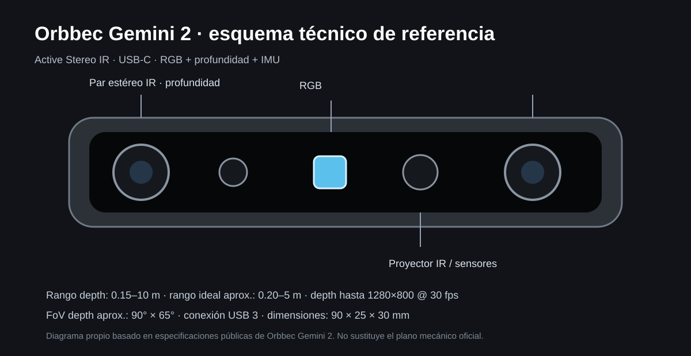
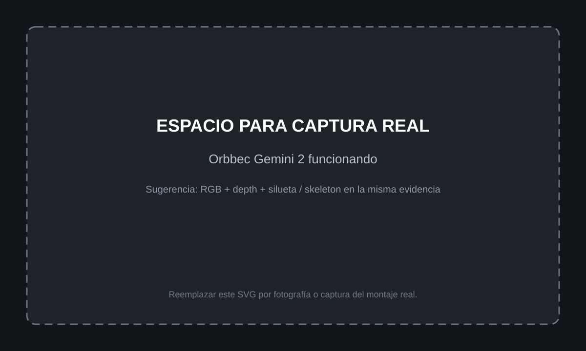

# 4B. Captura de profundidad: Orbbec + openFrameworks

Esta sección documenta la **ruta avanzada de captura corporal y espacial** del proyecto «Cuerpo, sensor y escena», basada en la implementación real desarrollada en el repositorio [Danza-Interactiva-Orbecc](https://github.com/joseurgilesc/Danza-Interactiva-Orbecc).

A diferencia del primer acercamiento con webcam + ml5.js, aquí se trabaja con:

- cámara **Orbbec RGB-D**;
- profundidad real alineada a color;
- **openFrameworks** como motor C++;
- **MediaPipe PoseLandmarker** como detector corporal;
- un adaptador C++ que combina pose 2D + profundidad real;
- silueta corporal obtenida desde el mapa de profundidad;
- escenas 2D y volumétricas 3D;
- mappings corporales X/Y/Z;
- OSC, MIDI, presets y secuenciación.

La progresión pedagógica se mantiene:

```text
webcam + ml5.js
      ↓
comprender coordenadas, gesto y mapeo
      ↓
Orbbec RGB-D
      ↓
profundidad real + pose
      ↓
openFrameworks
      ↓
escenas 2D / 3D / volumétricas
```

---

## 4B.0. Pruébalo tú mismo: clonar y ejecutar el repositorio

Si quieres reproducir el sistema completo que se documenta en esta página, trabaja directamente con el repositorio de desarrollo:

[github.com/joseurgilesc/Danza-Interactiva-Orbecc](https://github.com/joseurgilesc/Danza-Interactiva-Orbecc)

### 1. Clonar el repositorio

Desde una terminal:

```bash
cd ~/openFrameworks/apps/myApps
git clone https://github.com/joseurgilesc/Danza-Interactiva-Orbecc.git
cd Danza-Interactiva-Orbecc
```

Si ya lo habías clonado:

```bash
git pull
```

### 2. Revisar la estructura

Deberías encontrar, entre otros:

```text
Danza-Interactiva-Orbecc/
├── addons.make
├── bin/
├── config/
├── docs/
├── models/
├── pose_detector.py
├── run.sh
└── src/
    ├── adapters/
    ├── engine/
    ├── input/
    ├── mapping/
    ├── midi/
    ├── scenes/
    ├── sequencer/
    └── ui/
```

### 3. Instalar los addons de openFrameworks

El proyecto declara:

```text
ofxOsc
ofxImGui
ofxMidi
```

Comprueba que estén disponibles dentro de `openFrameworks/addons/`.

### 4. Crear el entorno Python para MediaPipe

```bash
python3.12 -m venv .venv
source .venv/bin/activate
pip install mediapipe numpy
```

El detector usa el modelo:

```text
models/pose_landmarker_lite.task
```

### 5. Probar solo el detector

```bash
python pose_detector.py
```

Deberías ver algo similar a:

```text
cargando modelo MediaPipe Pose...
modelo listo
escuchando en 127.0.0.1:5005
```

### 6. Conectar y verificar la Orbbec

Antes de iniciar openFrameworks:

1. conecta la cámara por USB 3.0;
2. abre Orbbec Viewer;
3. comprueba RGB;
4. comprueba depth;
5. confirma que la imagen de profundidad sea estable.

### 7. Compilar la aplicación openFrameworks

Desde la carpeta del proyecto:

```bash
make -j4
```

Si la compilación termina correctamente, puedes lanzar el sistema.

### 8. Arrancar todo con el script incluido

```bash
bash run.sh start
```

Comprobar estado:

```bash
bash run.sh status
```

Detener:

```bash
bash run.sh stop
```

### 9. Qué deberías comprobar al arrancar

En orden:

- la cámara Orbbec aparece;
- el detector MediaPipe responde;
- se dibuja el skeleton;
- los joints siguen el cuerpo;
- Z cambia al acercarte o alejarte;
- la silueta responde al threshold;
- las escenas pueden cambiarse;
- los mappings corporales afectan parámetros visuales.

!!! tip "Prueba mínima antes de modificar código"
    Ejecuta primero el repositorio **sin cambiar nada**. Cuando confirmes que el sistema base funciona, modifica una escena o un mapping. Esto hace más fácil distinguir un error de instalación de un error introducido durante la experimentación.

---

## 4B.0A. Cámara utilizada: Orbbec Gemini 2

<figure markdown>

<figcaption>Figura. Esquema técnico propio del Gemini 2, basado en las especificaciones públicas de Orbbec.</figcaption>
</figure>

El **Gemini 2** utiliza tecnología Active Stereo IR y ofrece RGB, profundidad e IMU en un dispositivo compacto. Para este proyecto son especialmente relevantes:

| Característica | Referencia |
| --- | --- |
| Conexión | USB 3 |
| Depth | hasta 1280 × 800 @ 30 fps |
| Rango de profundidad | 0.15–10 m |
| Rango recomendado | aprox. 0.20–5 m |
| FoV depth | aprox. 90° × 65° |
| D2C | soportado |
| SDK | Orbbec SDK v2 |
| Dimensiones | 90 × 25 × 30 mm |

Fuentes técnicas:

- [Orbbec Gemini 2](https://www.orbbec.com/products/stereo-vision-camera/gemini-2/)
- [Datasheet Gemini 2](https://www.orbbec.com/wp-content/uploads/2023/04/ORBBEC_Datasheet_Gemini-2.pdf)
- [Orbbec SDK v2](https://orbbec.github.io/OrbbecSDK_v2/)

---

## 4B.0B. Evidencias visuales del montaje

### Interfaz de openFrameworks en ejecución

<figure markdown>

<figcaption>Figura. Interfaz real del sistema en openFrameworks: escena <code>bodySilhouette</code> activa, panel de Kinect/Orbbec conectado, lista de escenas, controles ImGui, mappings y transporte. En el área central se observa la silueta corporal generativa construida a partir de profundidad.</figcaption>
</figure>

### Orbbec Gemini 2 funcionando

<figure markdown>

<figcaption>Figura pendiente. Reemplazar por una fotografía o captura del sistema mostrando RGB, depth y/o silueta corporal en funcionamiento.</figcaption>
</figure>

!!! note "Qué conviene fotografiar"
    Para que estas imágenes también sirvan como evidencia institucional, procura que una captura muestre **la interfaz completa de openFrameworks** y otra muestre **la cámara físicamente conectada junto con la salida RGB/depth o la silueta**. Así la imagen documenta tanto montaje como funcionamiento.

---

## 4B.1. Arquitectura real implementada

La arquitectura actual separa captura, detección y visualización:

```text
Orbbec RGB-D
   │
   ├── Color RGB 1280×720 @ 30 fps
   │        ↓
   │   submuestreo 480×270
   │        ↓
   │   pose_detector.py
   │   MediaPipe PoseLandmarker
   │        ↓
   │   33 landmarks
   │        ↓
   └── Depth Y16 alineado D2C
            ↓
      profundidad real en mm
            ↓
      OrbbecAdapter
            ↓
      18 joints X/Y/Z
            ↓
      DepthStore
            ↓
      silueta + contorno
            ↓
      SceneEngine
            ↓
      escenas 2D / 3D / OSC / MIDI
```

El elemento central es `OrbbecAdapter`, que se encuentra en:

- [src/adapters/kinect/OrbbecAdapter.cpp](https://github.com/joseurgilesc/Danza-Interactiva-Orbecc/blob/main/src/adapters/kinect/OrbbecAdapter.cpp)
- [src/adapters/kinect/OrbbecAdapter.h](https://github.com/joseurgilesc/Danza-Interactiva-Orbecc/blob/main/src/adapters/kinect/OrbbecAdapter.h)

!!! note "Nombre heredado"
    El proyecto conserva la interfaz `IKinectAdapter` y la carpeta `adapters/kinect/` por compatibilidad con la arquitectura original. Sin embargo, el backend activo puede ser Orbbec, MediaPipe o un adaptador simulado.

---

# 4B.2. Entorno probado en el proyecto

La implementación actual fue desarrollada y compilada en **Linux** con openFrameworks.

Los addons declarados en `addons.make` son:

```text
ofxOsc
ofxImGui
ofxMidi
```

Archivo:

- [addons.make](https://github.com/joseurgilesc/Danza-Interactiva-Orbecc/blob/main/addons.make)

La aplicación utiliza además:

- Orbbec SDK;
- MediaPipe Tasks para detección de pose;
- Python 3.12 para el detector;
- JSON para configuraciones y mappings;
- TCP local para comunicar openFrameworks con el detector de pose;
- OSC y MIDI como entradas adicionales del sistema.

---

# 4B.3. Instalación de openFrameworks

## Linux

1. Descarga openFrameworks desde:

   [https://openframeworks.cc/download/](https://openframeworks.cc/download/)

2. Descomprime el paquete.

3. Instala las dependencias siguiendo el script correspondiente de openFrameworks.

4. Coloca el proyecto dentro de:

```text
openFrameworks/
└── apps/
    └── myApps/
        └── Danza-Interactiva-Orbecc/
```

5. Instala los addons requeridos dentro de:

```text
openFrameworks/addons/
```

En particular:

- `ofxImGui`
- `ofxMidi`

`ofxOsc` normalmente viene incluido con openFrameworks.

6. Verifica primero que compile un ejemplo básico de openFrameworks.

!!! warning "No integrar Orbbec todavía"
    Antes de trabajar con la cámara, openFrameworks debe compilar correctamente por sí solo.

---

# 4B.4. Instalar Orbbec SDK

La implementación usa Orbbec SDK con la API C++:

```cpp
#include <libobsensor/ObSensor.hpp>
```

El SDK debe instalarse siguiendo las instrucciones oficiales del modelo de cámara utilizado.

Referencias:

- [Orbbec SDK](https://www.orbbec.com/developers/orbbec-sdk/)
- [Orbbec SDK v2](https://orbbec.github.io/OrbbecSDK_v2/)
- [Repositorio oficial](https://github.com/orbbec/OrbbecSDK_v2)

## Verificación previa

Antes de compilar la aplicación:

1. conecta la cámara por USB 3.0;
2. abre **Orbbec Viewer**;
3. verifica color;
4. verifica profundidad;
5. confirma que el stream sea estable.

!!! success "Regla de diagnóstico"
    Si Orbbec Viewer no muestra depth correctamente, el problema todavía no pertenece a openFrameworks.

---

# 4B.5. Cómo inicializa la cámara el proyecto real

`OrbbecAdapter::setupCamera()` crea un `ob::Pipeline`.

La implementación busca primero:

- color RGB;
- preferentemente **1280 × 720 a 30 fps**;
- profundidad en formato **Y16**;
- alineación **Depth-to-Color por hardware**.

Fragmento simplificado de la implementación:

```cpp
pipe_ = std::make_shared<ob::Pipeline>();

auto colorList = pipe_->getStreamProfileList(OB_SENSOR_COLOR);

// Selección de color RGB 1280x720 @ 30 fps.

auto d2cList =
    pipe_->getD2CDepthProfileList(
        colorProfile,
        ALIGN_D2C_HW_MODE
    );

// Selección de depth Y16.

auto config = std::make_shared<ob::Config>();
config->enableStream(colorProfile);
config->enableStream(depthProfile);
config->setAlignMode(ALIGN_D2C_HW_MODE);

pipe_->start(config, callback);
```

Esto es fundamental porque permite que un punto detectado en la imagen RGB pueda consultar la profundidad correspondiente en la misma posición.

---

# 4B.6. Color + profundidad alineada D2C

Cada frame entrega dos flujos:

```text
RGB
+
Depth
```

El depth se guarda como valores `uint16_t`.

```cpp
const uint16_t* data =
    reinterpret_cast<const uint16_t*>(
        depthFrame->getData()
    );
```

El proyecto conserva estos valores en:

```cpp
depthData_
```

y además los publica a un almacén compartido:

```cpp
DepthStore::instance().update(
    depthData_,
    depthW_,
    depthH_
);
```

Este mecanismo permite que las escenas accedan al mapa de profundidad sin depender directamente del adaptador de cámara.

---

# 4B.7. Detector de pose: MediaPipe como proceso separado

Una decisión importante del proyecto es **no ejecutar MediaPipe directamente dentro del hilo principal de openFrameworks**.

El flujo real es:

```text
OrbbecAdapter
      ↓
RGB 480×270
      ↓
TCP localhost:5005
      ↓
pose_detector.py
      ↓
MediaPipe PoseLandmarker
      ↓
33 landmarks JSON
      ↓
OrbbecAdapter
```

Archivo:

- [pose_detector.py](https://github.com/joseurgilesc/Danza-Interactiva-Orbecc/blob/main/pose_detector.py)

El detector utiliza:

```text
models/pose_landmarker_lite.task
```

y funciona como un servidor TCP local.

Protocolo:

```text
cliente → servidor
[uint32 width]
[uint32 height]
[RGB bytes]

servidor → cliente
[uint32 longitud]
[JSON con landmarks]
```

Este diseño desacopla el procesamiento de pose del renderer de openFrameworks.

---

# 4B.8. Instalar MediaPipe para el detector

El script `run.sh` del proyecto documenta una condición importante:

> MediaPipe debe ejecutarse con **Python 3.12** en el entorno utilizado, ya que versiones posteriores pueden no disponer del wheel requerido.

Ruta recomendada:

```bash
python3.12 -m venv .venv
source .venv/bin/activate
pip install mediapipe numpy
```

El detector puede probarse de forma independiente:

```bash
python pose_detector.py --host 127.0.0.1 --port 5005
```

Salida esperada:

```text
cargando modelo MediaPipe Pose...
modelo listo
escuchando en 127.0.0.1:5005
```

---

# 4B.9. Arranque automatizado del sistema

El proyecto incluye:

- [run.sh](https://github.com/joseurgilesc/Danza-Interactiva-Orbecc/blob/main/run.sh)

Uso:

```bash
bash run.sh start
bash run.sh status
bash run.sh stop
```

El script:

1. localiza el proyecto;
2. copia configuraciones hacia `bin/data/config`;
3. inicia `pose_detector.py`;
4. inicia la aplicación openFrameworks;
5. guarda logs separados.

Logs:

```text
detector.log
app.log
```

Esto simplifica mucho la operación en ensayo o escena.

---

# 4B.10. De 33 landmarks a 18 joints

MediaPipe entrega 33 landmarks.

El sistema los convierte en una representación corporal de **18 joints** compatible con la arquitectura del proyecto.

Entre ellos:

- cabeza;
- cuello;
- hombros;
- codos;
- muñecas;
- manos;
- columna media;
- base de columna;
- caderas;
- rodillas;
- tobillos.

El adaptador también calcula:

```text
NECK
SPINE_MID
SPINE_BASE
```

a partir de puntos medios.

---

# 4B.11. Profundidad Z real para cada articulación

La diferencia clave respecto a webcam + ml5.js es que aquí Z proviene del depth real.

Para cada articulación:

```text
landmark MediaPipe X/Y
        ↓
pixel correspondiente en depth
        ↓
valor en milímetros
        ↓
normalización near/far
        ↓
joint X/Y/Z
```

La función real del proyecto:

```cpp
float zReal =
    sampleDepthNormalized(r.x, r.y);
```

La profundidad se normaliza mediante:

```cpp
z = (mm - depthNearMM_)
    / (depthFarMM_ - depthNearMM_);
```

y se limita a:

```text
0.0 → 1.0
```

Así, el cuerpo deja de ser solamente una figura plana y pasa a tener un parámetro espacial real.

---

# 4B.12. Suavizado y estabilidad corporal

La posición de cada joint se suaviza temporalmente:

```cpp
current =
    ofLerp(previous, newValue, smoothingFactor);
```

Además, el sistema conserva el frame anterior cuando una articulación tiene baja confianza.

Esto reduce:

- jitter;
- saltos;
- vibración;
- pérdidas breves de tracking.

El parámetro se controla mediante:

```cpp
setSmoothing(...)
setConfidenceThreshold(...)
```

---

# 4B.13. DepthStore: silueta real del cuerpo

Una de las mejoras más importantes respecto a trabajar únicamente con joints es `DepthStore`.

Archivo:

- [DepthStore.h](https://github.com/joseurgilesc/Danza-Interactiva-Orbecc/blob/main/src/input/sensors/DepthStore.h)

El mapa de profundidad se reduce a una rejilla de:

```text
96 × 54
```

y aplica suavizado temporal mediante EMA.

Un punto pertenece al cuerpo si:

```cpp
depth > 0
&&
depth < thresholdMM
```

Valor inicial:

```text
2500 mm
```

Esto permite obtener una **silueta real basada en depth**, en lugar de aproximar el cuerpo con un polígono generado a partir de articulaciones.

---

# 4B.14. Contorno corporal

`DepthStore::contourPoints()` identifica las celdas de borde de la silueta.

Posteriormente ordena los puntos por ángulo respecto al centroide.

Esto solucionó un problema observado durante el desarrollo: un contorno sin ordenar produce líneas cruzadas o zigzag.

El commit correspondiente documenta esta corrección:

> contorno de silueta ordenado por ángulo — outline coherente, no zigzag.

---

# 4B.15. Ajustar el umbral de silueta

Durante la ejecución:

```text
,  → disminuir umbral
.  → aumentar umbral
```

Paso:

```text
200 mm
```

Rango:

```text
500 – 6000 mm
```

El valor se muestra como feedback en pantalla.

También aparece dentro del debug overlay.

Ejemplo:

```text
Silueta: 2500 mm
(',' baja / '.' sube)
```

---

# 4B.16. Persistencia del umbral

Al cerrar la aplicación se guarda:

```json
{
  "silhouetteThreshold": 2500
}
```

en:

```text
bin/data/config/depth.json
```

y se restaura al iniciar/cargar configuración.

Esto permite conservar la calibración entre sesiones.

---

# 4B.17. Escenas que utilizan profundidad real

La implementación ya no se limita a una prueba técnica.

Existen escenas que utilizan el depth y/o la silueta corporal.

Entre las más relevantes:

## BodySilhouetteScene

- utiliza la silueta real del cuerpo;
- genera partículas dentro de la figura;
- trabaja con presencia corporal completa.

[Ver código](https://github.com/joseurgilesc/Danza-Interactiva-Orbecc/blob/main/src/scenes/BodySilhouetteScene.cpp)

## BodyContourPaintScene

- obtiene puntos del contorno real;
- genera pintura/partículas desde los bordes corporales.

[Ver código](https://github.com/joseurgilesc/Danza-Interactiva-Orbecc/blob/main/src/scenes/BodyContourPaintScene.cpp)

## SilhouetteDepthTunnelScene

- utiliza la silueta como base de un túnel visual;
- integra profundidad con representación espacial.

[Ver código](https://github.com/joseurgilesc/Danza-Interactiva-Orbecc/blob/main/src/scenes/SilhouetteDepthTunnelScene.cpp)

## VolumetricLatticeScene

- construye una escena volumétrica;
- incorpora profundidad, estructura espacial y glow.

[Ver código](https://github.com/joseurgilesc/Danza-Interactiva-Orbecc/blob/main/src/scenes/VolumetricLatticeScene.cpp)

## VoxelFluidDisruptionScene

- explora una respuesta volumétrica tipo fluido/voxel.

[Ver código](https://github.com/joseurgilesc/Danza-Interactiva-Orbecc/blob/main/src/scenes/VoxelFluidDisruptionScene.cpp)

## DepthKineticVortexScene

- transforma datos corporales/depth en movimiento vorticial.

[Ver código](https://github.com/joseurgilesc/Danza-Interactiva-Orbecc/blob/main/src/scenes/DepthKineticVortexScene.cpp)

---

# 4B.18. Escenas 2D y escenas volumétricas 3D

El port desarrollado para Orbbec incorporó:

- **10 escenas 2D** vinculadas al cuerpo y la proximidad;
- **8 escenas volumétricas 3D**;
- una secuencia conceptual denominada **Génesis Volumétrica**;
- cámara fija;
- core motif;
- mappings X/Y/Z.

El sistema ya supera, por tanto, la etapa de “leer profundidad”: la profundidad funciona como una variable artística y escénica.

---

# 4B.19. Mapping corporal

La aplicación utiliza un motor de mappings.

Archivo principal de configuración:

- [config/kinect-mappings.json](https://github.com/joseurgilesc/Danza-Interactiva-Orbecc/blob/main/config/kinect-mappings.json)

La implementación inicial del port Orbbec incorporó **324 mappings** basados en vectores XYZ para las escenas.

La lógica general es:

```text
joint
  ↓
componente X / Y / Z
  ↓
normalización
  ↓
parámetro de escena
```

Ejemplos:

```text
mano derecha Y → altura de partículas
mano derecha Z → tamaño
distancia corporal → densidad
cadera X → desplazamiento
```

---

# 4B.20. OSC

El proyecto incluye `ofxOsc` y una arquitectura dedicada de OSC:

```text
src/adapters/
├── OSCAdapter.cpp
└── OSCSettings.cpp
```

Esto permite conectar los datos corporales o parámetros del sistema con otras aplicaciones.

OSC puede utilizarse para:

- audio externo;
- Ableton Live;
- Pure Data;
- Max;
- otras aplicaciones openFrameworks;
- herramientas de visualización.

---

# 4B.21. MIDI

El proyecto también utiliza:

```text
ofxMidi
```

y dispone de routing y MIDI Learn.

Esto permite utilizar controladores MIDI para:

- escenas;
- parámetros;
- cues;
- transiciones;
- operación en vivo.

El sistema incorpora además configuración persistente mediante JSON.

---

# 4B.22. UI con ofxImGui

La interfaz gráfica utiliza:

```text
ofxImGui
```

y un sistema de paneles para:

- escenas;
- parámetros;
- transporte;
- mappings;
- puertos de entrada.

La UI está pensada como una interfaz de operación del sistema, no únicamente como herramienta de desarrollo.

---

# 4B.23. Ciclo principal en openFrameworks

La estructura sigue el patrón habitual:

```cpp
void ofApp::setup() {
    // cámara
    // mappings
    // UI
    // OSC
    // MIDI
}

void ofApp::update() {
    kinectAdapter_->update();
    kinectMappingEngine_->update(delta);
    sceneEngine.update(delta);
}

void ofApp::draw() {
    sceneEngine.draw();
    skeletonView_->draw(...);
    uiManager.draw();
}
```

Esto mantiene separadas:

- adquisición de datos;
- mappings;
- lógica de escena;
- UI;
- render.

---

# 4B.24. Atajos útiles de la aplicación

Entre los controles implementados:

| Tecla | Función |
| --- | --- |
| `U` | mostrar/ocultar UI |
| `T` | transparencia de ventanas |
| `S` | guardar parámetros y mappings |
| `L` | cargar parámetros y mappings |
| `D` | debug overlay |
| `F` | pantalla completa |
| `M` | interacción con mouse |
| `,` | disminuir umbral de silueta |
| `.` | aumentar umbral de silueta |
| `R` | reiniciar tracking |
| ← / → | cambiar de escena |
| Shift + número | disparar cue |
| `[` / `]` | cue anterior / siguiente |
| F5 | recargar configuración MIDI |

---

# 4B.25. Prueba mínima recomendada

Antes de trabajar con las escenas complejas:

1. confirmar Orbbec en Viewer;
2. iniciar `pose_detector.py`;
3. iniciar la aplicación openFrameworks;
4. comprobar que aparecen joints;
5. mostrar skeleton;
6. mover el cuerpo;
7. comprobar Z;
8. activar una escena basada en depth;
9. ajustar el umbral;
10. cerrar y comprobar que el threshold se conserva.

---

# 4B.26. Diagnóstico de errores

## No hay cámara

Revisar:

- USB 3.0;
- alimentación;
- SDK;
- permisos;
- Orbbec Viewer.

## Hay color pero no profundidad

Revisar:

- perfil depth;
- formato Y16;
- compatibilidad D2C;
- modelo/firmware.

## Hay cámara pero no skeleton

Comprobar primero:

```bash
python pose_detector.py
```

Luego:

```bash
bash run.sh status
```

y revisar:

```text
detector.log
app.log
```

## MediaPipe no instala

Usar Python 3.12 en un entorno virtual.

## La silueta incluye demasiado fondo

Disminuir:

```text
silhouetteThreshold
```

con `,`.

## La silueta corta partes del cuerpo

Aumentar el threshold con `.`.

## El contorno vibra

La implementación aplica:

- downsampling;
- EMA temporal;
- orden por ángulo alrededor del centroide.

Si todavía existe ruido, revisar iluminación, rango y superficie del fondo.

---

# 4B.27. Ruta didáctica propuesta

## Ejercicio 1 — Depth como dato

Observar la distancia del cuerpo.

```text
Z → tamaño
```

## Ejercicio 2 — Zona espacial

```text
cerca → respuesta A
medio → respuesta B
lejos → respuesta C
```

## Ejercicio 3 — Joint XYZ

Elegir una articulación y mapear:

```text
X → posición
Y → color
Z → escala
```

## Ejercicio 4 — Silueta

Utilizar `DepthStore::isBody()` para llenar solamente el cuerpo.

## Ejercicio 5 — Contorno

Utilizar `contourPoints()` para generar elementos desde el límite corporal.

## Ejercicio 6 — Escena volumétrica

Transformar profundidad en:

- perspectiva;
- partículas;
- lattice;
- voxels;
- túneles;
- campos de fuerza.

---

# 4B.28. Evolución real del desarrollo

El historial del repositorio documenta una progresión clara:

### 15 de octubre de 2026

Port a Orbbec con:

- color + depth D2C;
- MediaPipe;
- 18 joints con Z real;
- 10 escenas 2D;
- 8 escenas volumétricas 3D;
- 324 mappings XYZ.

### 20 de octubre

Se incorpora silueta real mediante depth:

- `DepthStore`;
- `BodySilhouetteScene`;
- `BodyContourPaint`;
- `SilhouetteDepthTunnel`.

### 24 de octubre

Umbral de silueta ajustable.

### 27 de octubre

Feedback visual del threshold.

### 30 de octubre

Contorno ordenado por ángulo para evitar zigzag.

### 4 de noviembre

Persistencia del threshold entre sesiones.

### 9 de noviembre

Pulido estético:

- silueta más estable;
- core motif con halo;
- lattice con glow.

---

# 4B.29. Archivos clave del repositorio

## Captura y tracking

- [OrbbecAdapter.cpp](https://github.com/joseurgilesc/Danza-Interactiva-Orbecc/blob/main/src/adapters/kinect/OrbbecAdapter.cpp)
- [OrbbecAdapter.h](https://github.com/joseurgilesc/Danza-Interactiva-Orbecc/blob/main/src/adapters/kinect/OrbbecAdapter.h)
- [pose_detector.py](https://github.com/joseurgilesc/Danza-Interactiva-Orbecc/blob/main/pose_detector.py)
- [DepthStore.h](https://github.com/joseurgilesc/Danza-Interactiva-Orbecc/blob/main/src/input/sensors/DepthStore.h)

## Aplicación

- [ofApp.cpp](https://github.com/joseurgilesc/Danza-Interactiva-Orbecc/blob/main/src/ofApp.cpp)
- [ofApp.h](https://github.com/joseurgilesc/Danza-Interactiva-Orbecc/blob/main/src/ofApp.h)
- [run.sh](https://github.com/joseurgilesc/Danza-Interactiva-Orbecc/blob/main/run.sh)

## Configuración

- [kinect-mappings.json](https://github.com/joseurgilesc/Danza-Interactiva-Orbecc/blob/main/config/kinect-mappings.json)
- [sequence.json](https://github.com/joseurgilesc/Danza-Interactiva-Orbecc/blob/main/config/sequence.json)
- [midi.json](https://github.com/joseurgilesc/Danza-Interactiva-Orbecc/blob/main/config/midi.json)

## Addons

- [addons.make](https://github.com/joseurgilesc/Danza-Interactiva-Orbecc/blob/main/addons.make)

---

# 4B.30. Resultado alcanzado

La integración Orbbec del proyecto ya permite:

- recibir color y depth;
- alinear profundidad con color;
- obtener pose con MediaPipe;
- generar 18 joints;
- añadir Z real a cada joint;
- suavizar tracking;
- construir una silueta corporal desde depth;
- obtener un contorno estable;
- ajustar y guardar el umbral de profundidad;
- mapear XYZ a parámetros escénicos;
- ejecutar escenas 2D y volumétricas;
- utilizar OSC y MIDI;
- operar el sistema mediante UI;
- automatizar el arranque con scripts.

Esto permite considerar la integración Orbbec + openFrameworks como una **implementación funcional avanzada**, no solamente como una prueba de concepto.
