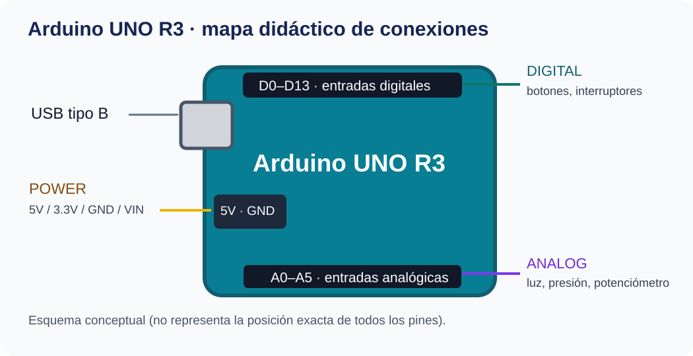
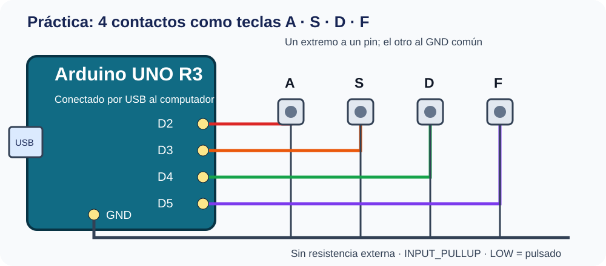

# 6. Arduino e interfaces físicas

> **Meta práctica:** crear un instrumento físico que transforme gestos o contactos en letras (**A, S, D, F**) para controlar imagen y sonido, como con Makey Makey.

## 6.1. Conoce el Arduino UNO R3

Arduino UNO R3 es una placa basada en el microcontrolador ATmega328P. El programa («sketch») se carga por USB y se ejecuta en la placa, incluso sin mantener abierto el entorno de programación.

**Observa la placa real y contrasta el esquema:** [Fotografía y características oficiales](https://docs.arduino.cc/hardware/uno-rev3/) · [Mapa oficial completo de pines (PDF)](https://content.arduino.cc/assets/A000066-full-pinout.pdf).

| Zona | ¿Qué hace? | Uso creativo |
| --- | --- | --- |
| **USB tipo B** | Conecta Arduino al PC para alimentación, programación y datos serie | Envío de acciones al computador |
| **D2–D13 digitales** | Detectan HIGH/LOW o generan salidas | Pulsadores, contacto de materiales conductores |
| **D0/RX y D1/TX** | Comunicación serie UART | Evítalos en el primer ejercicio con USB |
| **A0–A5 analógicas** | Miden de 0 a 1023 en el UNO R3 (ADC de 10 bits) | Luz, presión, potenciómetro |
| **5V y 3.3V** | Alimentación de periféricos compatibles | Sensores |
| **GND** | Referencia eléctrica común | Retorno de pulsadores |
| **VIN** | Entrada de alimentación externa (no sensor) | Proyectos autónomos |
| **RESET** | Reinicia el programa | Diagnóstico |

!!! warning "Seguridad"
    Haz las conexiones con el USB desconectado. No conectes directamente 5 V a GND; no conectes tensiones superiores a las admitidas por los pines. El UNO R3 trabaja con lógica de **5 V**.

## 6.2. Instalar Arduino IDE y comprobar la placa

1. Descarga **[Arduino IDE 2 desde la web oficial](https://www.arduino.cc/en/software/)** e instálalo.
2. Conecta el UNO R3 usando un **cable USB de datos**.
3. En el IDE selecciona **Herramientas → Placa → Arduino AVR Boards → Arduino Uno**. Si no aparece, instala *Arduino AVR Boards* desde el gestor de placas.
4. Ve a **Herramientas → Puerto** y elige el puerto que aparece al conectar la placa.
5. Abre **Archivo → Ejemplos → 01.Basics → Blink** y pulsa **Subir** (flecha).
6. Comprueba que parpadea el LED integrado marcado **L**. ¡La instalación funciona!

=== "Windows"
    El puerto suele llamarse **COM3**, **COM4**, etc. Si falta, comprueba el cable, el controlador USB de la placa y el Administrador de dispositivos.
=== "macOS"
    Busca puertos del tipo **/dev/cu.usbmodem*** o **/dev/cu.usbserial***.
=== "Linux"
    Busca **/dev/ttyACM0** o **/dev/ttyUSB0**. Puede ser necesario configurar permisos del dispositivo serial y reglas udev según tu distribución.

Consulta también la [guía oficial de instalación](https://support.arduino.cc/hc/en-us/articles/360019833020-Download-and-install-Arduino-IDE).

## 6.3. Leer entradas digitales: una pulsación

**Materiales:** 1 Arduino UNO R3, 1 pulsador, una protoboard, cables Dupont, cable USB.

Conecta **D2 → pulsador → GND**. Activa la resistencia interna mediante \`INPUT_PULLUP\`. Así, **sin pulsar = HIGH** y **pulsado = LOW**. Un pulsador de cuatro terminales tiene pares de patas internamente unidos: verifica cuáles cierran el contacto.

~~~cpp
const byte boton = 2;

void setup() {
  pinMode(boton, INPUT_PULLUP);
  Serial.begin(115200);
}

void loop() {
  Serial.println(digitalRead(boton) == LOW ? "PULSADO" : "LIBRE");
  delay(100);
}
~~~

Abre **Herramientas → Monitor serie**, selecciona **115200 baudios** y comprueba que cambia el texto al pulsar. Cierra el monitor antes de utilizar cualquier programa externo que lea ese puerto.

## 6.4. Construir cuatro teclas físicas A, S, D y F

Conecta un extremo de cada pulsador al pin indicado y el otro extremo al **GND común**.

| Entrada Arduino | Acción | Letra enviada |
| --- | --- | --- |
| D2 | Contacto 1 | **A** |
| D3 | Contacto 2 | **S** |
| D4 | Contacto 3 | **D** |
| D5 | Contacto 4 | **F** |

Carga este **sketch completo**, que informa de cada cambio de estado (presionar o soltar) y elimina rebotes mecánicos:

~~~cpp
const byte pines[4] = {2, 3, 4, 5};
const char letras[4] = {'a', 's', 'd', 'f'};
bool estadoEstable[4] = {HIGH, HIGH, HIGH, HIGH};
bool lecturaAnterior[4] = {HIGH, HIGH, HIGH, HIGH};
unsigned long ultimoCambio[4] = {0, 0, 0, 0};
const unsigned long reboteMs = 30;

void setup() {
  Serial.begin(115200);
  for (byte i = 0; i < 4; i++) {
    pinMode(pines[i], INPUT_PULLUP);
    estadoEstable[i] = digitalRead(pines[i]);
    lecturaAnterior[i] = estadoEstable[i];
  }
}

void loop() {
  for (byte i = 0; i < 4; i++) {
    bool lectura = digitalRead(pines[i]);
    if (lectura != lecturaAnterior[i]) ultimoCambio[i] = millis();

    if (millis() - ultimoCambio[i] > reboteMs &&
        lectura != estadoEstable[i]) {
      estadoEstable[i] = lectura;
      Serial.print(letras[i]);
      Serial.println(estadoEstable[i] == LOW ? ",DOWN" : ",UP");
    }
    lecturaAnterior[i] = lectura;
  }
}
~~~

El Monitor serie mostrará, por ejemplo, \`a,DOWN\` al presionar y \`a,UP\` al soltar.

## 6.5. Hacer que Arduino UNO escriba letras como Makey Makey

!!! important "Arduino UNO R3 ≠ teclado USB nativo"
    En el **UNO R3**, \`Keyboard.h\` no funciona como en Arduino Leonardo o Micro: el UNO R3 transmite datos por **Serial**. Para convertir esos mensajes en teclas del sistema operativo necesitamos un **puente** en el PC. Para teclado USB directo, utiliza un Leonardo, Micro o una placa compatible HID.

Instala Python 3 desde [python.org](https://www.python.org/downloads/), abre una terminal y ejecuta:

~~~bash
python -m pip install pyserial pynput
~~~

Crea un archivo **\`arduino_teclado.py\`** con este contenido:

~~~python
import sys
import serial
from pynput.keyboard import Controller

if len(sys.argv) < 2:
    raise SystemExit("Uso: python arduino_teclado.py PUERTO")

teclado = Controller()
permitidas = {"a", "s", "d", "f"}
pulsadas = set()

with serial.Serial(sys.argv[1], 115200, timeout=1) as arduino:
    print("Controlador activo. Ctrl+C para salir.")
    try:
        while True:
            mensaje = arduino.readline().decode("ascii", errors="ignore").strip()
            if "," not in mensaje:
                continue
            letra, accion = mensaje.split(",", 1)
            if letra not in permitidas:
                continue
            if accion == "DOWN" and letra not in pulsadas:
                teclado.press(letra)
                pulsadas.add(letra)
            elif accion == "UP" and letra in pulsadas:
                teclado.release(letra)
                pulsadas.remove(letra)
    except KeyboardInterrupt:
        pass
    finally:
        for letra in pulsadas:
            teclado.release(letra)
~~~

Con el Monitor serie **cerrado**, ejecútalo sustituyendo el puerto:

~~~bash
# Windows (ejemplo)
python arduino_teclado.py COM3

# macOS (ejemplo)
python3 arduino_teclado.py /dev/cu.usbmodemXXXX

# Linux (ejemplo)
python3 arduino_teclado.py /dev/ttyACM0
~~~

Abre un editor de texto, selecciona su ventana y pulsa los contactos: deberían aparecer letras. La ventana activa recibe las teclas. En macOS, es posible que debas autorizar el control de accesibilidad; en Linux con **Wayland**, la simulación de teclado mediante \`pynput\` puede no funcionar. En ese caso usa X11, una solución compatible con tu compositor o envía los datos directamente por Serial a una aplicación propia.

!!! tip "Seguridad de software"
    Ejecuta el puente solo cuando sea necesario; para detenerlo usa **Ctrl+C**. Puede enviar letras a cualquier ventana que tenga el foco.

## 6.6. Conectar Makey Makey y Arduino: ¿son lo mismo?

**No.** Makey Makey ya se presenta como teclado USB: cierra el circuito entre una entrada (SPACE, LEFT, UP, W, A, S, D, F, G, etc., según modelo) y **EARTH**, y el computador recibe una tecla. Arduino UNO R3, en cambio, necesita el puente anterior para imitar ese comportamiento.

### Opción A — Recomendación para clase: ambos al mismo computador

~~~text
Objetos conductores → Makey Makey ─USB→ PC → p5.js / Tone.js
Botones o sensores  → Arduino UNO ─USB/Serial→ PC → aplicación
~~~

Puedes usar ambos a la vez: Makey Makey para letras y Arduino para valores continuos (luz, presión, distancia). En la aplicación, los eventos de teclado se leen con \`keydown\` y los datos Arduino con Web Serial o un puente. **No hace falta unir físicamente ambas placas.**

### Opción B — Conexión física Makey Makey → Arduino UNO

Para que Arduino detecte **si se ha activado alguna tecla Makey Makey**:

1. Localiza en la **cara posterior** de tu Makey Makey los pines rotulados **KEY_OUT** y **GND**. La disposición cambia entre revisiones: guíate por las etiquetas impresas, no por la posición.
2. Con ambas placas desconectadas, conecta **KEY_OUT → D2** del UNO y **GND → GND** del UNO.
3. Alimenta **cada placa por su propio USB** al computador y prueba con el siguiente programa.
4. En Makey Makey, une una entrada con **EARTH**. Arduino detectará cuándo se activa la salida KEY_OUT.

~~~cpp
const byte entradaMakey = 2;
bool anterior = LOW;

void setup() {
  pinMode(entradaMakey, INPUT);
  Serial.begin(115200);
}

void loop() {
  bool actual = digitalRead(entradaMakey) == HIGH;
  if (actual != anterior) {
    Serial.println(actual ? "MAKEY_ACTIVADO" : "MAKEY_LIBRE");
    anterior = actual;
  }
  delay(10);
}
~~~

!!! warning "Límite de KEY_OUT"
    **KEY_OUT no indica qué letra se pulsó**: solo señala que hay alguna entrada de teclado activada. No conectes por error el pin de alimentación **5V** a D2, ni unas entre sí las salidas de ambas placas. Consulta las etiquetas de tu versión de Makey Makey. Esta opción asume niveles de salida compatibles con una entrada de **5 V** del UNO R3 y masa compartida.

Para identificar **cada tecla por separado**, la vía más sencilla es usar Makey Makey por USB (el navegador sabe qué tecla llega) y Arduino por USB/Serial (el programa sabe qué sensor se mueve). Como alternativa avanzada, los contactos individuales pueden cablearse a entradas propias del UNO, siempre comprobando el circuito y las referencias de tierra.

Fuentes: [Makey Makey: parte posterior y KEY_OUT](https://makeymakey.com/blogs/how-to-instructions/back-of-the-board-tutorial) · [Makey Makey FAQ](https://makeymakey.com/pages/faq).

## 6.7. Entradas analógicas: luz y presión

Para obtener una variación continua, conecta un **potenciómetro de 10 kΩ**: extremos a 5V y GND, terminal central a **A0**. Lee el valor:

~~~cpp
void setup() { Serial.begin(115200); }
void loop() {
  int valor = analogRead(A0);
  Serial.println(valor); // 0 a 1023 en UNO R3
  delay(30);
}
~~~

Un **sensor LDR** requiere normalmente divisor de tensión; un **FSR** necesita una resistencia de referencia. No conectes una fotorresistencia o un FSR sin considerar el circuito de lectura.

## 6.8. Del sensor a una escena

1. **Acción corporal:** tocar una superficie conductora o presionar un botón.
2. **Lectura:** Makey Makey detecta una tecla o Arduino detecta LOW/HIGH.
3. **Comunicación:** teclado USB o Serial.
4. **Interpretación:** el navegador o programa recibe el evento.
5. **Respuesta:** reproducir un sonido en Tone.js, dibujar una forma en p5.js o cambiar una escena.

### Práctica de aula · instrumento de cuatro zonas

**Desafío:** construye cuatro contactos con papel aluminio, cartón, cinta conductora o pulsadores. Asigna A/S/D/F a cuatro sonidos o comportamientos gráficos diferentes. Debes demostrar una pulsación, una liberación y la respuesta observable.

**Entrega:** fotografía de conexiones, captura del Monitor serie, código comentado y video de 30–60 segundos del instrumento funcionando.

## 6.9. Diagnóstico rápido

| Síntoma | Qué revisar |
| --- | --- |
| No aparece el puerto | USB de datos, controlador, permisos |
| Error al subir Blink | Placa y puerto correctos; cierra programas que ocupen el puerto |
| El botón no cambia | D2→pulsador→GND, posición de patas, INPUT_PULLUP |
| Letras no aparecen | Programa Python ejecutándose, puerto correcto, ventana con foco |
| Mensaje de puerto ocupado | Cerrar Monitor serie antes del puente |
| Se envían muchas letras | Revisar antirrebote y contactos |
| Makey Makey no activa Arduino | Identificar KEY_OUT y GND de la revisión correcta; probar cada placa por separado |
| Wayland no permite teclado | Enviar Serial a la aplicación o elegir una solución compatible con Wayland |

**Siguiente unidad:** [7. Comunicación entre hardware y software](07-comunicacion.md).
